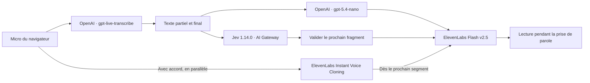

# Interprète

Traduction vocale pour deux personnes qui parlent à tour de rôle sur **un seul appareil**. Next.js, TypeScript et Tailwind CSS.

## Démarrer

```sh
npm ci
cp .env.example .env.local
# Renseigner les quatre variables serveur dans .env.local.
npm run dev
```

Ouvrir `http://localhost:3035`. Choisir les deux langues, puis utiliser le bouton de la personne qui parle. La traduction commence pendant sa prise de parole, par petits segments, sans attendre l’arrêt du micro. Le micro reste ouvert pendant les pauses et la lecture ; seul le bouton Terminer clôt son tour. Les touches **A**, **B** et **Échap** permettent aussi de piloter la session.

Le bouton d’exemple utilise un enregistrement synthétique pour tester toute la chaîne sans microphone. Il ne sert jamais au clonage.

## Architecture



- Le navigateur capture du PCM 24 kHz par trames de 20 ms et se connecte à OpenAI avec un jeton éphémère délivré par `/api/session`. La capture et la connexion commencent en parallèle ; les premières trames attendent en mémoire si la connexion n’est pas encore prête. Les clés permanentes restent sur le serveur.
- `/api/interpret` traduit en streaming et communique avec ElevenLabs par WebSocket. La réponse audio revient au navigateur en SSE.
- OpenAI utilise `gpt-live-transcribe` avec `delay: minimal`. Ses deltas sont découpés en fragments lexicaux ; Jev estime quand un fragment peut être traduit sans attendre une phrase entière. Un contexte des mots suivants aide à attendre une négation ou un nombre incomplet. Jev ne garantit ni la vérité de la transcription ni la qualité de la traduction.
- Les items ASR sont finalisés séparément toutes les 30 secondes ou à une pause, sans arrêter la capture. Les transcriptions finales sont associées à leur `item_id`. Les connexions sont renouvelées après 45 minutes avec une seconde connexion préparée en parallèle ; une reconnexion rejoue le tampon non finalisé (60 secondes maximum). Une panne plus longue est signalée.
- Chaque segment autorisé est immédiatement envoyé à la synthèse. Les paquets audio sont lus dès leur réception, dans l’ordre, alors que le micro reste ouvert. Le curseur des mots déjà prononcés évite de rejouer toute la phrase à la validation finale. La dernière portion est traduite à la fin du tour.
- L’annulation d’écho du navigateur est activée (mode `all` lorsqu’il est disponible). Son efficacité acoustique dépend du navigateur, du microphone et du volume des haut-parleurs. La collecte de clonage exclut les périodes de sortie audio et émet des petits fichiers WAV pendant que le micro continue.
- Chaque profil possède sa langue, sa voix et ses échantillons. Le clonage démarre en arrière-plan après environ 30 secondes de parole autorisée, ou manuellement à partir de 10 secondes. La voix provisoire reste disponible pendant la création ; le clone est utilisé dès le prochain segment disponible. Un clone qui demande une vérification supplémentaire n’est pas activé.
- Une nouvelle tentative de clonage recherche d’abord la voix déjà créée pour ce consentement, profil et session. Cela permet de récupérer une réponse réseau perdue sans réutiliser la voix d’une personne précédente.

Il n’y a ni base de données ni enregistrement des conversations sur le serveur de l’app. Les 30 derniers passages et les trois derniers audios de réécoute restent en mémoire dans l’onglet. Les préférences et autorisations de voix sont conservées dans ce navigateur. Les voix clonées sont hébergées chez ElevenLabs jusqu’à leur suppression ; les fournisseurs appliquent leurs propres règles de conservation aux requêtes.

## Variables serveur

| Variable | Usage |
| --- | --- |
| `INTERPRETER_OPENAI_API_KEY` | Transcription et traduction OpenAI |
| `ELEVENLABS_API_KEY` | Synthèse, inventaire, création et suppression des voix |
| `AI_GATEWAY_API_KEY` | Évaluation Jev ; la traduction finale fonctionne aussi sans ce service |
| `SESSION_SECRET` | Signature des sessions et autorisations de voix ; valeur aléatoire longue |

La clé ElevenLabs doit autoriser la lecture de l’inventaire, le text-to-speech et la gestion des voix. Ne jamais préfixer ces variables par `NEXT_PUBLIC_`, les committer ou les inclure dans un rapport.

## Vérification

```sh
npm run typecheck
npm run lint
npm run test:app
npm run build
```

Les tests couvrent les signatures, la séparation des voix, le consentement, les flux incomplets, la lecture avant l’arrêt de la capture, l’absence de répétition finale et le démarrage parallèle. `npx tsx scripts/verify-live-app.ts <synthetic-24khz.wav>` teste silencieusement les vraies API, sans haut-parleur. Les anciens scripts de benchmark restent dans `scripts/` ; ils utilisent les services payants et ne sont pas exécutés par les tests de l’app.

Voir [les vérifications effectuées](docs/VALIDATION.md). Les latences de démonstration sont des observations sur quelques phrases, pas un benchmark représentatif de toutes les langues et conditions réseau.

## Déploiement

Projet Vercel : **interprete-live**, équipe **VoiceCheap**, région **Paris (`cdg1`)**. Les quatre secrets sont configurés uniquement côté serveur. La protection Vercel limite l’accès aux personnes autorisées, afin de protéger les API payantes. Les limites locales de requêtes constituent un complément, pas un quota distribué.

Le clonage d’une voix réelle nécessite l’accord de cette personne et un échantillon propre. Les deux personnes prennent toujours la parole à tour de rôle ; seule la traduction synthétique chevauche la parole. L’identification automatique des personnes et la séparation de deux voix humaines simultanées ne sont pas prises en charge.

Références : [transcription continue OpenAI](https://developers.openai.com/api/docs/guides/realtime-transcription), [streaming ElevenLabs](https://elevenlabs.io/docs/eleven-api/guides/how-to/websockets/realtime-tts).
