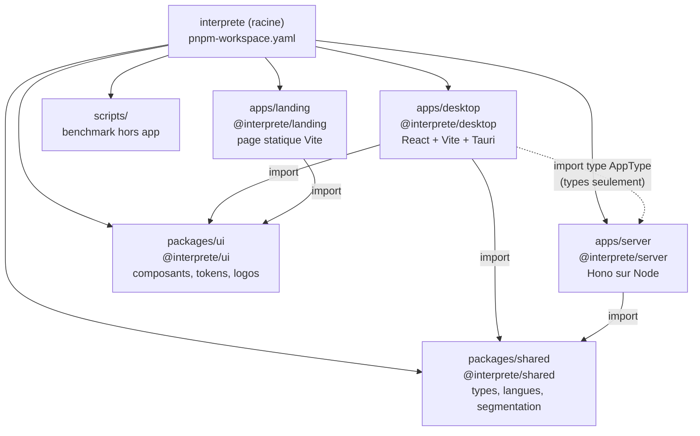
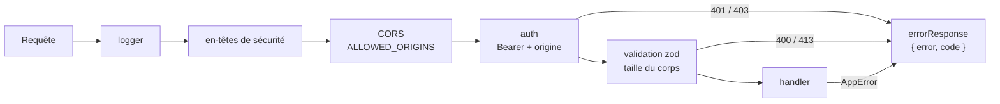
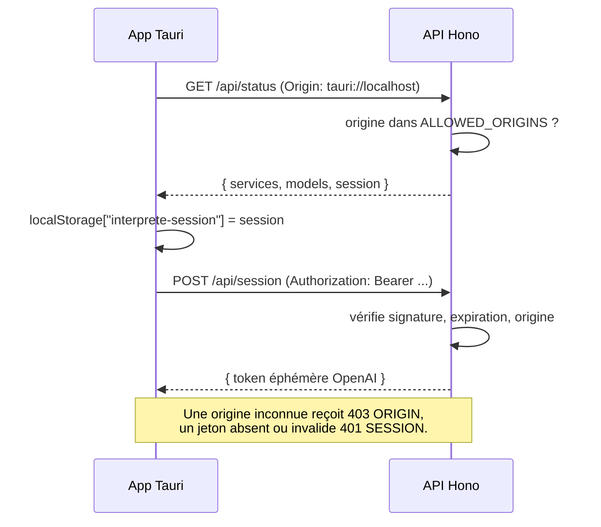
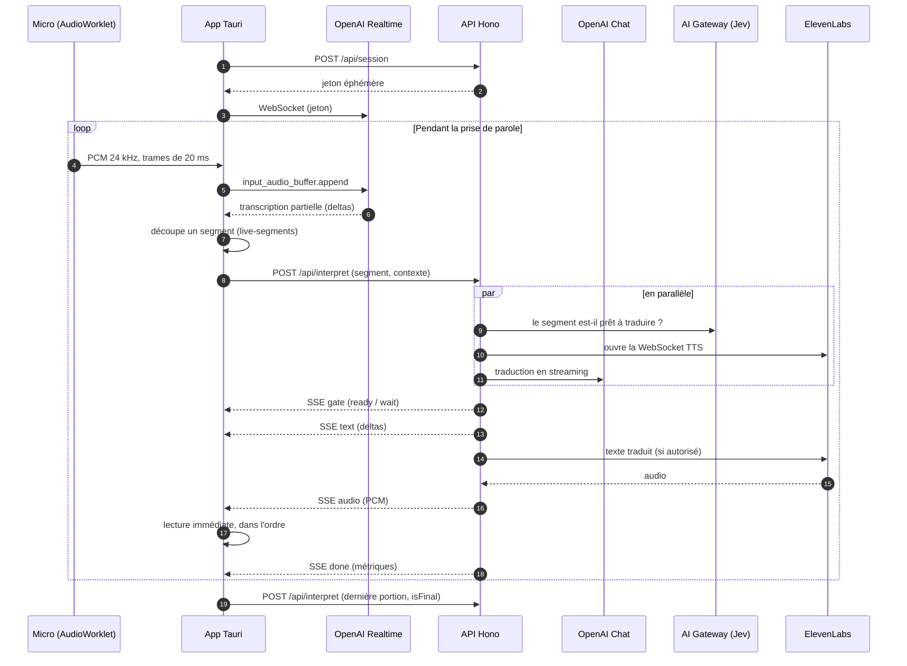
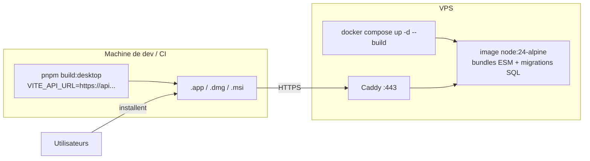

# Architecture

Interprète traduit à voix haute deux personnes parlant à tour de rôle sur un même appareil. Son interface React/Vite fonctionne dans l’app [Tauri 2](https://v2.tauri.app) ou dans un navigateur HTTPS. L’API commune Hono conserve les clés fournisseurs côté serveur. Le socle comptes/préférences utilise PostgreSQL.

Le déploiement web utilise deux projets du workspace Vercel VoiceCheap : `interprete-live` (racine `apps/desktop`, sortie `dist`) et `interprete-backend` (racine `apps/server`, Hono en région Frankfurt), avec Neon pour PostgreSQL. `interprete-live` est relié au dépôt GitHub `kevinrss01/interprete-live-v2` (branche de production `main`) ; `interprete-backend` n’a pas de dépôt relié et se déploie par la CLI. `VITE_API_URL` est intégré au build web ; `ALLOWED_ORIGINS` et les origines de confiance Better Auth autorisent ce domaine sur l’API. L’entrée Vercel charge le bundle ESM `dist/app.mjs` pour éviter les imports TypeScript sans extension à l’exécution. Le serveur autonome et le déploiement VPS ci-dessous restent disponibles.

## Vue d'ensemble

- Les **clés permanentes** (OpenAI, ElevenLabs, AI Gateway, secret de session) restent sur le backend ; elles ne sont pas incluses dans le bundle web ou desktop.
- La **transcription** est la seule connexion directe app → fournisseur : l'API délivre un jeton OpenAI éphémère, puis la webview envoie le PCM du micro directement à OpenAI Realtime, sans passer par le VPS.
- La **traduction et la voix** passent par l'API, qui renvoie le texte et l'audio en SSE.

## Monorepo

Workspace pnpm (`pnpm-workspace.yaml`). Tauri ne connaît que `apps/desktop` ; le workspace relie les paquets entre eux.

| Paquet | Rôle | Fichiers clés |
| --- | --- | --- |
| `apps/desktop` | Toute l'app. Le front est un export statique (`dist/`) embarqué par Tauri. | `src/lib/interpreter.ts` (orchestration d'un tour), `transcription.ts` (OpenAI Realtime), `audio.ts` (capture et lecture), `api.ts` (client RPC), `src-tauri/` (Rust, config, permissions) |
| `apps/server` | API HTTP du VPS. Bundles ESM `dist/server.mjs` et `dist/db/migrate.mjs`. | `src/app.ts` (assemblage, CORS), `src/routes/*.ts` (un endpoint audio par fichier), `src/rpc/` (comptes/préférences), `src/auth.ts`, `src/db/`, `src/server.ts` (démarrage), `src/lib/*` (fournisseurs, sessions, validation) |
| `packages/shared` | Code utilisé des deux côtés, publié en TypeScript source. | `contracts.ts`, `languages.ts`, `live-segments.ts`, `text.ts` |
| `packages/ui` | Design system partagé par le desktop et la landing, publié en source (TSX/CSS, sans build). | `src/components/*` (primitives shadcn), `src/styles.css` (Tailwind, tokens, police), `src/assets/` (logos), `components.json` |
| `apps/landing` | Landing page statique. Vercel la construit avec Root Directory `apps/landing`. | `index.html`, `src/main.css` (importe `@interprete/ui/styles.css`) |

Le desktop importe **uniquement le type** `AppType` du serveur : le client `hc<AppType>` connaît les routes, leurs entrées et leurs réponses. Modifier une route casse la compilation du desktop, pas l'app en production. Aucun code serveur n'est embarqué dans le bundle desktop.

## API

| Méthode | Route | Auth | Limite | Rôle |
| --- | --- | --- | --- | --- |
| GET | `/api/status` | — | — | Services configurés, modèles, et session signée (créée ou renouvelée) |
| POST | `/api/session` | Bearer | 20 / min | Jeton OpenAI Realtime éphémère pour une langue |
| POST | `/api/interpret` | Bearer | 120 / min | Traduction + synthèse, réponse en SSE |
| POST | `/api/voice/clone` | Bearer | 4 / h | Clone la voix d'un profil (multipart, accord requis) |
| POST | `/api/voice/delete` | Bearer | — | Supprime un clone appartenant à cette session |
| POST | `/api/voice/match` | Bearer | 20 / min | Choisit une voix ElevenLabs prédéfinie proche d’un interlocuteur d’appel (Jev), à partir de mesures calculées sur l’appareil |

`POST /api/interpret` accepte `speak: false` pour les sous-titres d’appel : la réponse SSE contient le feu vert et le texte, sans synthèse vocale ni résolution de voix.

Chaîne de traitement d’une requête audio dans `src/routes/`, montée par `src/app.ts` :

L'authentification passe avant la validation : une requête sans session reçoit 401, pas 400.

## Session et sécurité

L’interpréteur actuel utilise un jeton Bearer pour éviter la dépendance aux cookies entre Tauri et le domaine du VPS. Cette session anonyme est un jeton signé (HMAC `SESSION_SECRET`, 30 jours) envoyé en `Authorization: Bearer`.

- **Origines** : `tauri://localhost` (macOS, Linux), `http://tauri.localhost` (Windows), `http://localhost:1420` (dev Vite). Configurables via `ALLOWED_ORIGINS`.
- **Voix clonées** : l'app ne reçoit jamais l'identifiant ElevenLabs brut, mais une autorisation signée liée à la session et au profil (`voiceGrant`). Elle ne peut ni utiliser ni supprimer la voix d'une autre session.
- **Limites** : les limites de requêtes sont en mémoire, ce qui suppose une seule instance de l'API.
- **Ce que la session ne protège pas** : n'importe quel client qui appelle `/api/status` obtient une session. Le socle Better Auth protège uniquement `/rpc/*`. Pour réserver aussi l’API payante aux comptes, il faudra migrer explicitement ses routes et les autorisations de voix.

## Comptes et préférences

Le serveur comprend un socle Hono + oRPC + Zod + Better Auth + Drizzle + PostgreSQL. Les procédures `account.me`, `preferences.get` et `preferences.update` sont montées sous `/rpc/*` et protégées par une session utilisateur. Le frontend audio conserve son client Hono et ses sessions anonymes.

Aucune méthode de connexion n’est encore activée. Le frontend, le stockage des jetons et la reprise des préférences locales restent à intégrer.

Le [guide backend](backend.md) décrit la structure des fichiers, les contrôles, les tables, les procédures, un exemple de client frontend, le démarrage local, les migrations, les tests et le déploiement.

## Déroulé d'un tour de parole

- **Lecture pendant la parole** : le micro reste ouvert pendant la lecture. L'annulation d'écho du navigateur limite le retour du haut-parleur.
- **Découpage** : tant que la personne parle, le dernier mot attend le début du suivant : il peut être incomplet, et il donne à Jev un mot d'anticipation. Après 250 ms sans nouveau mot, il est considéré comme complet, pour ne pas retenir une phrase dont l'ASR ajoute la ponctuation tard. Tant qu'aucun son d'un fragment n'a été lu, il est retiré puis reproposé si l'ASR révise ses mots ou prolonge son dernier mot, ou si les mots suivants annoncent une négation ou la suite d'un montant. Un fragment refusé après une pause est reproposé dès qu'une ponctuation forte le termine.
- **Feu vert** : un segment est prononcé si Jev l'estime prêt (probabilité ≥ 0,6) ou s'il se termine par une ponctuation forte. Jev n'est pas appelé quand la règle locale suffit : portion finale, ponctuation forte, ou fin inutilisable (préposition, article, mot composé coupé, négation ou nombre annoncés par la suite). Un fragment refusé arrête aussitôt sa traduction et sa synthèse, ce qui libère la requête suivante. Si Jev ne répond pas, on attend la fin de la phrase.
- **Traduction** : le modèle reçoit le fragment et ce qui a déjà été prononcé (source et traduction entendue), mais pas les mots suivants : les petits modèles les traduisaient en avance, puis une seconde fois dans le fragment suivant.
- **Voix** : les silences ajoutés par ElevenLabs autour de chaque fragment sont retirés (20 ms gardés avant, 60 ms après), sans jamais retarder un échantillon audible ; une pause livrée en retard n'est pas rejouée après le trou qu'elle a déjà laissé dans la lecture. L'app indique avec chaque fragment la durée de traduction qui attend encore d'être lue (`queued`) : le serveur accélère alors légèrement la voix (de 1 à 1,2, la limite d'ElevenLabs) pour rattraper la personne ; une traduction à jour garde le débit naturel de la voix.
- **Renouvellement** : la connexion Realtime est renouvelée après 45 minutes, avec une seconde connexion préparée en parallèle ; les items sont finalisés toutes les 30 secondes ou à chaque pause.

## Déploiement

- **API** : copier le repo et `apps/server/.env.local` sur le VPS, puis `API_DOMAIN=api.example.com docker compose up -d --build`. Caddy obtient le certificat et relaie le SSE sans buffering (`flush_interval -1`).
- **Desktop** : `VITE_API_URL` est intégré au moment du build ; le pointer vers le domaine du VPS avant `pnpm build:desktop`. Sur macOS, `Info.plist` déclare l'usage du micro et `Entitlements.plist` l'autorise sous hardened runtime. La signature et la notarisation ne sont pas encore configurées.

## Variables d'environnement

| Où | Variable | Usage |
| --- | --- | --- |
| `apps/server/.env.local` | `INTERPRETER_OPENAI_API_KEY` | Transcription et traduction |
| | `ELEVENLABS_API_KEY` | Synthèse, clonage et suppression des voix |
| | `AI_GATEWAY_API_KEY` | Jev ; optionnel, la traduction finale fonctionne sans |
| | `SESSION_SECRET` | Signature des sessions et des autorisations de voix |
| | `DATABASE_URL` | PostgreSQL pour les comptes et préférences |
| | `BETTER_AUTH_URL` | URL publique de l’API |
| | `BETTER_AUTH_SECRET` | Secret Better Auth distinct, 32 caractères minimum |
| | `ALLOWED_ORIGINS` | Origines autorisées (CORS et contrôle de session) |
| | `PORT` | Port d'écoute, 3035 par défaut |
| `apps/desktop/.env.local` | `VITE_API_URL` | URL de l'API, intégrée au build |
