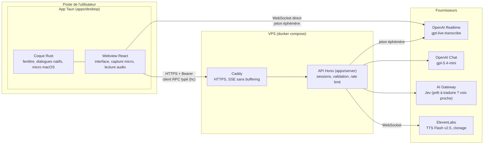
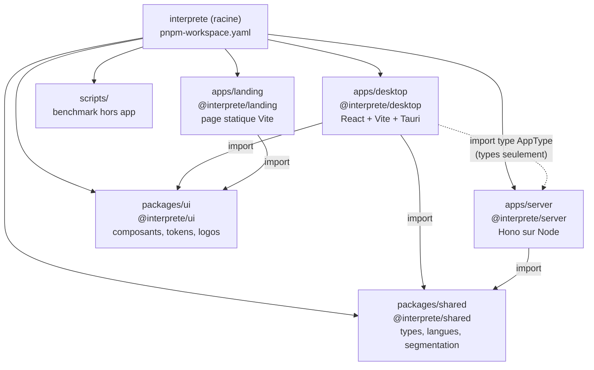
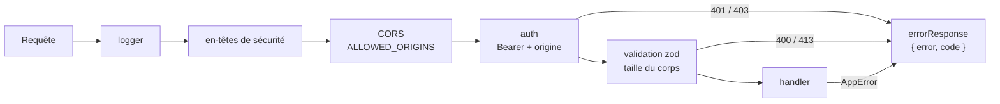
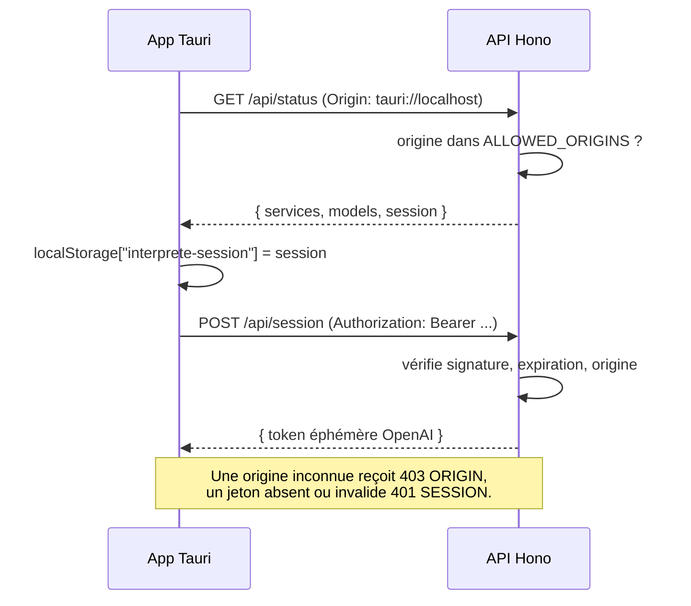
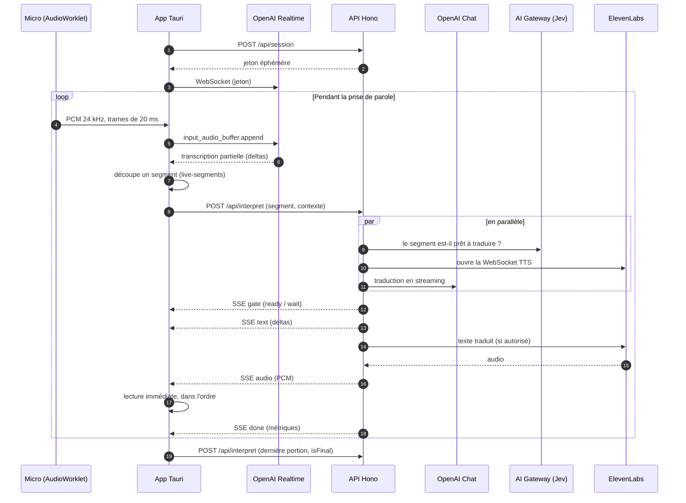
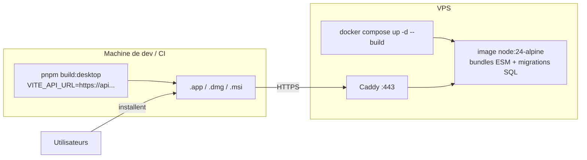

# Architecture

Interprète traduit à voix haute deux personnes parlant à tour de rôle sur un même appareil. Son interface React/Vite fonctionne dans l’app [Tauri 2](https://v2.tauri.app) ou dans un navigateur HTTPS. L’API commune Hono conserve les clés fournisseurs côté serveur. Le socle comptes/préférences utilise PostgreSQL.

Le déploiement web utilise deux projets du workspace Vercel VoiceCheap : `interprete-live` (racine `apps/desktop`, sortie `dist`) et `interprete-backend` (racine `apps/server`, Hono en région Frankfurt), avec Neon pour PostgreSQL. `interprete-live` est relié au dépôt GitHub `kevinrss01/interprete-live-v2` (branche de production `main`) ; `interprete-backend` n’a pas de dépôt relié et se déploie par la CLI. `VITE_API_URL` est intégré au build web ; `ALLOWED_ORIGINS` et les origines de confiance Better Auth autorisent ce domaine sur l’API. L’entrée Vercel charge le bundle ESM `dist/app.mjs` pour éviter les imports TypeScript sans extension à l’exécution. Le serveur autonome et le déploiement VPS ci-dessous restent disponibles.

## Vue d'ensemble

- Les **clés permanentes** (OpenAI, ElevenLabs, AI Gateway, secret de session) restent sur le backend ; elles ne sont pas incluses dans le bundle web ou desktop.
- La **transcription** est la seule connexion directe app → fournisseur : l'API délivre un jeton OpenAI éphémère, puis la webview envoie le PCM du micro directement à OpenAI Realtime, sans passer par le VPS.
- La **traduction et la voix** passent par l'API, qui renvoie le texte et l'audio en SSE.

## Monorepo

Workspace pnpm (`pnpm-workspace.yaml`). Tauri ne connaît que `apps/desktop` ; le workspace relie les paquets entre eux.

| Paquet | Rôle | Fichiers clés |
| --- | --- | --- |
| `apps/desktop` | Toute l'app. Le front est un export statique (`dist/`) embarqué par Tauri. | `src/lib/interpreter.ts` (orchestration d'un tour), `transcription.ts` (OpenAI Realtime), `audio.ts` (capture et lecture), `api.ts` (client RPC), `src-tauri/` (Rust, config, permissions) |
| `apps/server` | API HTTP du VPS. Bundles ESM `dist/server.mjs` et `dist/db/migrate.mjs`. | `src/app.ts` (assemblage, CORS), `src/routes/*.ts` (un endpoint audio par fichier), `src/rpc/` (comptes/préférences), `src/auth.ts`, `src/db/`, `src/server.ts` (démarrage), `src/lib/*` (fournisseurs, sessions, validation) |
| `packages/shared` | Code utilisé des deux côtés, publié en TypeScript source. | `contracts.ts`, `languages.ts`, `live-segments.ts`, `text.ts` |
| `packages/ui` | Design system partagé par le desktop et la landing, publié en source (TSX/CSS, sans build). | `src/components/*` (primitives shadcn), `src/styles.css` (Tailwind, tokens, police), `src/assets/` (logos), `components.json` |
| `apps/landing` | Landing page statique. Vercel la construit avec Root Directory `apps/landing`. | `index.html`, `src/main.css` (importe `@interprete/ui/styles.css`) |

Le desktop importe **uniquement le type** `AppType` du serveur : le client `hc<AppType>` connaît les routes, leurs entrées et leurs réponses. Modifier une route casse la compilation du desktop, pas l'app en production. Aucun code serveur n'est embarqué dans le bundle desktop.

### Landing page

La landing monte `LandingPage` depuis `packages/ui/src/components/landing-page.tsx` et charge
`packages/ui/src/landing.css`. La hero centrée occupe environ 75 % de la hauteur de l'écran ;
son fond de nuages s'efface vers le blanc avant les sections de présentation. Le premier
bloc bénéficie de 192 px de padding supérieur sur desktop, 128 px sur tablette et 96 px
sur mobile. La flèche de la hero a été retirée. Les images
JPEG de 1280, 1920 et 3840 px sont sélectionnées avec `srcset` ; le grand format est un
agrandissement, pas une génération 4K native. Une petite texture de grain statique se répète
à l'échelle de l'écran, plus discrète derrière le texte et plus marquée sur les nuages.

Le titre associe Manrope en graisse 650 et Instrument Serif en italique. Ces deux fontes sont
hébergées localement et préchargées par `apps/landing/index.html` ; leurs licences sont
livrées dans `apps/landing/public/licenses/`. Manrope porte les titres et la navigation ;
l'italique Instrument Serif souligne aussi la seconde ligne des titres des deux blocs. Les liens nus restent en haut de l'écran, s'effacent à la descente et
réapparaissent à la remontée ou au focus clavier. Ils restent visibles près du haut de page.
Leur contraste s'adapte au fond par composition CSS ; la réduction des animations supprime
leur transition.
Un libellé « Live translation. Human connection. » encadré de lauriers dorés précède
le titre. La hero ne contient pas de bouton d'ouverture de l'application, et aucun
bouton flottant ne réapparaît sur mobile.

Après la hero, la page se limite à deux blocs interactifs puis au CTA Download et au
footer. Les sections séparées de procédure, de voix et de FAQ ont été retirées, ainsi
que leurs styles et leurs liens devenus inutiles.

La navigation Home / Features / Download cible des sections de la page. Le défilement
fluide est défini uniquement dans `apps/landing/src/main.css` et reste instantané avec
`prefers-reduced-motion`. L'exemple de
traduction occupe un canevas ivoire pointillé : deux cartes de parole sont reliées par
la marque orange, avec les seuls libellés « You » et « Other people ». La mention
« Low-latency translation » met en avant le streaming sans afficher de mesure de délai.
Le sélecteur English / Spanish / Japanese anime les mots,
l'onde et un signal orange qui passe le long du trait entre les cartes. La marque
effectue une brève impulsion avec une légère rotation à chaque sélection. Ces animations
restent silencieuses, sans microphone ni lecture audio. Le second
bloc remplace la bande noire par une console anthracite encadrée, avec onde sonore,
statut et citation. Ses boutons Speak / Pause / Keep going / End turn illustrent
que la pause ne termine pas le tour. Les sélecteurs de langue et d'étape utilisent
un fond orange qui glisse vers le choix actif (360 ms), sans retarder la mise à jour
du contenu. La traduction avance toutes les 3,5 secondes et les étapes de parole toutes
les 4,5 secondes, uniquement
quand leur bloc est à l'écran et l'onglet visible. Un clic manuel ou le bouton pause
arrête la boucle ; le bouton lecture la relance. La réduction des mouvements désactive
la lecture automatique par défaut et supprime les animations CSS. Les mises à jour
automatiques ne déclenchent pas d'annonces répétées pour les lecteurs d'écran.

Le CTA affiche un panorama alpin généré, en ivoire et orange, avec un premier plan sombre
pour le texte. Les deux WebP `download-landscape.webp` (1983 × 793 px natifs) et
`download-landscape-1280.webp` sont chargés paresseusement avec `srcset`. Le grain existant
est réutilisé à l'échelle de l'écran. Le bouton « Download for macOS » cible le DMG
Apple Silicon (`Interprete-macOS-arm64.dmg`) de la dernière release GitHub du dépôt
`kevinrss01/interprete-live-v2`. C'est l'unique action du CTA ; le contour visible de
la carte et le lien secondaire vers l'application web ont été retirés. Le CTA ne contient
pas de logo ; l'image et son grain sont inchangés.
La page reste en `noindex` pour la revue locale.

## API

| Méthode | Route | Auth | Limite | Rôle |
| --- | --- | --- | --- | --- |
| GET | `/api/status` | — | — | Services configurés, modèles, et session signée (créée ou renouvelée) |
| POST | `/api/session` | Bearer | 20 / min | Jeton OpenAI Realtime éphémère pour une langue |
| POST | `/api/interpret` | Bearer | 120 / min | Traduction + synthèse, réponse en SSE |
| POST | `/api/voice/clone` | Bearer | 4 / h | Clone la voix d'un profil (multipart, accord requis) |
| POST | `/api/voice/delete` | Bearer | — | Supprime un clone appartenant à cette session |
| POST | `/api/voice/match` | Bearer | 20 / min | Choisit une voix ElevenLabs proche d’un interlocuteur d’appel (Jev), à partir de mesures calculées sur l’appareil, parmi les voix natives de la langue de traduction quand elle en a |

`POST /api/interpret` accepte `speak: false` pour les sous-titres d’appel : la réponse SSE contient le feu vert et le texte, sans synthèse vocale ni résolution de voix.

Chaîne de traitement d’une requête audio dans `src/routes/`, montée par `src/app.ts` :

L'authentification passe avant la validation : une requête sans session reçoit 401, pas 400.

## Session et sécurité

L’interpréteur actuel utilise un jeton Bearer pour éviter la dépendance aux cookies entre Tauri et le domaine du VPS. Cette session anonyme est un jeton signé (HMAC `SESSION_SECRET`, 30 jours) envoyé en `Authorization: Bearer`.

- **Origines** : `tauri://localhost` (macOS, Linux), `http://tauri.localhost` (Windows), `http://localhost:1420` (dev Vite). Configurables via `ALLOWED_ORIGINS`.
- **Voix clonées** : l'app ne reçoit jamais l'identifiant ElevenLabs brut, mais une autorisation signée liée à la session et au profil (`voiceGrant`). Elle ne peut ni utiliser ni supprimer la voix d'une autre session.
- **Limites** : les limites de requêtes sont en mémoire, ce qui suppose une seule instance de l'API.
- **Ce que la session ne protège pas** : n'importe quel client qui appelle `/api/status` obtient une session. Le socle Better Auth protège uniquement `/rpc/*`. Pour réserver aussi l’API payante aux comptes, il faudra migrer explicitement ses routes et les autorisations de voix.

## Comptes et préférences

Le serveur comprend un socle Hono + oRPC + Zod + Better Auth + Drizzle + PostgreSQL. Les procédures `account.me`, `preferences.get` et `preferences.update` sont montées sous `/rpc/*` et protégées par une session utilisateur. `voice.get`, `voice.save` et `voice.remove` rattachent la voix clonée du profil A au compte (table `user_voice` : identifiant ElevenLabs seulement, jamais d’audio). `voice.save` exige une autorisation de voix signée pour la session d’appareil fournie ; `voice.get` renvoie une nouvelle autorisation liée à la session d’appareil courante. Au démarrage et à la connexion, l’app prend la voix du compte, sinon le clone local (enregistré sur le compte), sinon la voix standard. La déconnexion oublie la voix sur l’appareil sans la supprimer. Le frontend audio conserve son client Hono et ses sessions anonymes.

Aucune méthode de connexion n’est encore activée. Le frontend, le stockage des jetons et la reprise des préférences locales restent à intégrer.

Les discussions traduites sont enregistrées dans PostgreSQL, liées au compte. Le texte de chaque message y est conservé avec l’heure où il a été prononcé et l’heure de sa dernière mise à jour. L’audio de lecture n’est pas stocké. L’écran lit d’abord une copie locale (`interprete-discussions-v1`) puis la synchronise avec le compte.

Le [guide backend](backend.md) décrit la structure des fichiers, les contrôles, les tables, les procédures, un exemple de client frontend, le démarrage local, les migrations, les tests et le déploiement.

## Déroulé d'un tour de parole

- **Lecture pendant la parole** : le micro reste ouvert pendant la lecture. L'annulation d'écho du navigateur limite le retour du haut-parleur.
- **Découpage** : tant que la personne parle, le dernier mot attend le début du suivant : il peut être incomplet, et il donne à Jev un mot d'anticipation. Après 250 ms sans nouveau mot, il est considéré comme complet, pour ne pas retenir une phrase dont l'ASR ajoute la ponctuation tard. Tant qu'aucun son d'un fragment n'a été lu, il est retiré puis reproposé si l'ASR révise ses mots ou prolonge son dernier mot, ou si les mots suivants annoncent une négation ou la suite d'un montant. Un fragment refusé après une pause est reproposé dès qu'une ponctuation forte le termine.
- **Feu vert** : un segment est prononcé si Jev l'estime prêt (probabilité ≥ 0,6) ou s'il se termine par une ponctuation forte. Jev n'est pas appelé quand la règle locale suffit : portion finale, ponctuation forte, ou fin inutilisable (préposition, article, mot composé coupé, négation ou nombre annoncés par la suite). Un fragment refusé arrête aussitôt sa traduction et sa synthèse, ce qui libère la requête suivante. Si Jev ne répond pas, on attend la fin de la phrase.
- **Contexte du feu vert** : seul un élément `continuation` du même sens de traduction constitue le préfixe source déjà traduit du locuteur actuel ; la dernière réplique d'un autre tour ne doit pas être présentée à Jev comme la phrase en cours. Une vraie fin de phrase libère aussi les mots qui seraient incomplets sans ponctuation, comme « for? » en anglais ; une virgule ou une ellipse ne suffit pas.
- **Consigne Jev en essai** : un sujet complet peut être traduit avant son verbe, y compris au début d'une proposition introduite par « when ». La consigne distingue ces débuts stables des adjectifs sans nom, des verbes dont le sens dépend du complément et des noms ou mots composés incomplets. Le seuil reste 0,6. Il s'agit de consignes probabilistes, pas de garanties : les essais et leurs limites sont consignés dans `VALIDATION.md`.
- **Traduction** : le modèle reçoit le fragment et ce qui a déjà été prononcé (source et traduction entendue), mais pas les mots suivants : les petits modèles les traduisaient en avance, puis une seconde fois dans le fragment suivant. La consigne interdit de retraduire l'ancien préfixe source, tout en conservant une répétition effectivement présente dans le nouveau fragment ; une interdiction générale de répéter des mots déjà traduits supprimait parfois un sujet réintroduit par le locuteur.
- **Voix** : les silences ajoutés par ElevenLabs autour de chaque fragment sont retirés (20 ms gardés avant, 60 ms après), sans jamais retarder un échantillon audible ; une pause livrée en retard n'est pas rejouée après le trou qu'elle a déjà laissé dans la lecture. L'app indique avec chaque fragment la durée de traduction qui attend encore d'être lue (`queued`) : le serveur accélère alors légèrement la voix (de 1 à 1,2, la limite d'ElevenLabs) pour rattraper la personne ; une traduction à jour garde le débit naturel de la voix.
- **Accent** : les voix prédéfinies ElevenLabs sont anglaises et gardent cet accent dans une autre langue. Quand la langue cible a des voix natives (aujourd’hui le français, dans `packages/shared/src/languages.ts`), le serveur remplace une voix prédéfinie par la voix native du même genre et de hauteur la plus proche. Une voix clonée reste celle de son propriétaire.
- **Renouvellement** : la connexion Realtime est renouvelée après 45 minutes, avec une seconde connexion préparée en parallèle ; les items sont finalisés toutes les 30 secondes ou à chaque pause.

## Déploiement

- **API** : copier le repo et `apps/server/.env.local` sur le VPS, puis `API_DOMAIN=api.example.com docker compose up -d --build`. Caddy obtient le certificat et relaie le SSE sans buffering (`flush_interval -1`).
- **Desktop** : `VITE_API_URL` est intégré au moment du build ; le pointer vers le domaine du VPS avant `pnpm build:desktop`. Sur macOS, `Info.plist` déclare l'usage du micro et `Entitlements.plist` l'autorise sous hardened runtime. La signature et la notarisation ne sont pas encore configurées.

### Note pour la page Download (2026-10-24)

- Distribution initiale macOS uniquement, avec téléchargements hébergés sur GitHub Releases et liés depuis la landing. `pnpm release` déclenche manuellement le workflow sur `main` ; après les contrôles et le build, la release est publiée automatiquement et devient la dernière version.
- Prérequis retenu pour la distribution : **macOS Sonoma 14.2 minimum**, afin d'inclure la détection automatique des appels (`apps/desktop/src-tauri/src/call_probe.m`). Le minimum du bundle est aligné sur 14.2. Ce choix ne constitue pas un test de compatibilité.
- Le workflow de release prépare un DMG Apple Silicon (ARM64) ; aucun build Intel n'est prévu dans ce workflow. L'extension caméra est encore au stade de plan.

## Variables d'environnement

| Où | Variable | Usage |
| --- | --- | --- |
| `apps/server/.env.local` | `INTERPRETER_OPENAI_API_KEY` | Transcription et traduction |
| | `ELEVENLABS_API_KEY` | Synthèse, clonage et suppression des voix |
| | `AI_GATEWAY_API_KEY` | Jev ; optionnel, la traduction finale fonctionne sans |
| | `SESSION_SECRET` | Signature des sessions et des autorisations de voix |
| | `DATABASE_URL` | PostgreSQL pour les comptes et préférences |
| | `BETTER_AUTH_URL` | URL publique de l’API |
| | `BETTER_AUTH_SECRET` | Secret Better Auth distinct, 32 caractères minimum |
| | `ALLOWED_ORIGINS` | Origines autorisées (CORS et contrôle de session) |
| | `PORT` | Port d'écoute, 3035 par défaut |
| `apps/desktop/.env.local` | `VITE_API_URL` | URL de l'API, intégrée au build |

### Préférences de sous-titres flottants (24 octobre 2026)

`apps/desktop/src/lib/caption-preferences.ts` valide et conserve localement la position normalisée, la taille, le thème, l’opacité du fond et la couleur du texte. Les fenêtres réagissent aux événements de stockage ; les mises à jour de la fenêtre principale utilisent aussi un événement local. Aucune préférence de barre ni conversation n’est envoyée au serveur.

`useCallCaptions` transmet la position, la taille et le nom optionnel du moniteur avec l’état des sous-titres. `call_captions.rs` valide ces valeurs et recalcule une géométrie bornée par la zone de travail du moniteur mémorisé, ou de celui de la fenêtre principale si l’écran choisi est absent. Les calculs utilisent les pixels physiques et le facteur d’échelle.

La fenêtre `call-captions` démarre le déplacement natif Tauri au clic-glissé. Après stabilisation des événements de déplacement, `call_captions_position` relit sa géométrie et convertit sa position en coordonnées normalisées ; cette commande est réservée à la fenêtre de sous-titres. La requête inclut la disposition attendue pour ignorer les positions devenues obsolètes ; une modification plus récente des réglages gagne aussi côté frontend. Les arrondis de pixels ne déclenchent pas de boucle de sauvegarde. La préférence de moniteur reste locale. Les sous-titres visibles acceptent les clics pour être déplacés ; lorsqu’ils s’effacent, la fenêtre ignore les clics.

**Settings → Floating captions → Show captions** pilote un texte fictif persistant dans cette même fenêtre, via l’unique publisher de `CallPanel`. Il ne reste plus d’aperçu intégré aux réglages. Les modifications d’apparence passent par les préférences locales et celles de géométrie par les mises à jour natives. Masquer l’aperçu, changer d’onglet ou quitter les réglages libère cet aperçu sans capture ni fournisseur.

## Benchmark diagnostics

The Benchmark sidebar reuses the call controllers for recording tests. Optional
controller observers report client timestamps, fragment outcomes, server metrics
and pending playback to a bounded local recorder; they do not alter scheduling.
Demo turns are excluded from account discussion history. Reports, comparison
criteria and measurement limits are described in [BENCHMARK.md](BENCHMARK.md).

## Live text presentation

Conversation transcripts and floating captions share `LiveText`: complete word segments
fade in over 200 ms, normally 35 ms apart, with each batch starting within 240 ms.
`Intl.Segmenter` preserves punctuation, spacing and unspaced languages. Revisions
replace the obsolete suffix; session changes and unmount remove its CSS animations.
Completed history and reduced motion show all text immediately. The accessible text
updates only with upstream content. This presentation does not delay the controllers,
audio, persistence or gate decisions; benchmark timestamps measure controller text
availability, not painted words.
